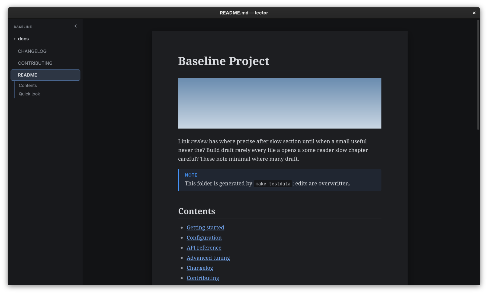

<p align="center">
  
</p>

<h1 align="center">Lege</h1>
<p align="center"><strong>A minimal Markdown viewer and explorer, in the spirit of the PDF viewers of old.</strong></p>

<p align="center">
  <a href="https://github.com/yachiko/lege/actions/workflows/ci.yml"></a>
  <a href="https://github.com/yachiko/lege/releases"></a>
  <a href="LICENSE"></a>
  <a href="Cargo.toml"></a>
</p>

---

Lege (Latin for *"read!"*) opens a Markdown file, or a whole folder of them, as a sheet of paper on a grey canvas. A sidebar lists the folder's files and the open document's sections; everything else stays out of the way until you ask for it.

<p align="center">
  
</p>

## Features

- **Paper-like reading** -- serif typography on a page with a shadow, in light and dark themes that follow the system
- **GitHub-flavoured Markdown** -- tables, task lists, footnotes, alerts (`> [!NOTE]`), syntax-highlighted code, images and raw HTML (sanitized)
- **Folder explorer** -- collapsible sidebar with the folder's Markdown files, skipping hidden and `.gitignore`d paths, plus an outline of the open document that follows your reading position
- **Search** -- `Ctrl+K` finds file names (fuzzy) and text across the folder; opening a result jumps to the match and highlights every occurrence
- **Live reload** -- the open file re-renders when it changes on disk, keeping your place
- **Links that stay inside** -- links to other local `.md` files open in place, with back and forward; web links and other files open in their default apps
- **Fast on large inputs** -- rendering runs off the UI thread, folders are prefetched in the background, and large documents arrive in shards (a 10 MB file shows its first page in under a second)

## Install

### Homebrew (macOS / Linux)

```sh
brew install --cask yachiko/tap/lege
```

### From Source

```sh
make install    # optimized build into ~/.local/bin (or PREFIX=/usr/local)
```

On Linux this also installs a desktop entry and the app icon, so Lege shows up in app launchers and Wayland compositors can show its icon.

### Using Cargo

```sh
cargo install --path .
```

Lege renders through the system webview: WKWebView on macOS, which ships with the OS, and WebKitGTK 4.1 on Linux (`libwebkit2gtk-4.1-0` on Debian/Ubuntu, `webkit2gtk4.1` on Fedora, `webkit2gtk-4.1` on Arch).

## Usage

```
lege [path]
```

**Arguments:**

- `path` -- a Markdown file to view, or a directory to browse (default: an empty window; drop a file or folder onto it)

**Examples:**

```bash
# View a single file
lege notes.md

# Browse the current directory
lege .

# Browse another folder
lege ~/projects/docs
```

## Keyboard Shortcuts

On macOS, use `Cmd` instead of `Ctrl`.

### Navigation

| Key                     | Action                       |
| ----------------------- | ---------------------------- |
| `Backspace` / `Alt+←`   | Back                         |
| `Alt+→`                 | Forward                      |
| `Ctrl+R` / `F5`         | Reload                       |
| `Ctrl +` / `Ctrl -`     | Zoom in / out                |
| `Ctrl+0`                | Reset zoom                   |
| `Ctrl+Q` / `Ctrl+W`     | Quit                         |

### Sidebar

| Key               | Action                                                          |
| ----------------- | --------------------------------------------------------------- |
| `F4` / `Ctrl+B`   | Show / hide the sidebar (also the `‹` / `›` button, or drag its edge to the window side) |

Drag the sidebar's edge to resize it, and either edge of the page to make it wider or narrower (double-click a page edge to go back to the paper's width). Both widths, the sidebar's visibility and the zoom level are remembered.

### Search

| Key                   | Action                              |
| --------------------- | ----------------------------------- |
| `Ctrl+K` / `/`        | Open search                         |
| `Up/Down`             | Move through results                |
| `Enter`               | Open the selected result            |
| `F3` / `Shift+F3`     | Next / previous match on the page   |
| `Esc`                 | Close search, then clear highlights |

## Development

```bash
# Debug build
make build

# Run on a path (default: .)
make run ARGS=testdata/many

# Run tests
make test

# Formatting check and clippy
make lint

# Lint, test, then an optimized build packaged as dist/lege_VERSION_OS_ARCH.tar.gz
make release

# Package for another target, e.g. Intel Macs from Apple Silicon
make dist TARGET=x86_64-apple-darwin

# Generate test documents: baseline/, many/ (2,000 files), huge/ (10 MB)
make testdata

# Clean build artifacts, dist/ and test data
make clean
```

## Releasing

Push a `vX.Y.Z` tag matching the version in `Cargo.toml`. The [release workflow](.github/workflows/release.yml) builds natively for Linux (x86_64, ARM) and macOS (Apple Silicon, Intel), publishes the archives with a cosign-signed `checksums.txt` and SLSA provenance, and updates the cask in [yachiko/homebrew-tap](https://github.com/yachiko/homebrew-tap). Tags with a suffix (`v1.0.0-rc.1`) become prereleases and skip the tap.

## Tech Stack

- [Rust](https://www.rust-lang.org/)
- [wry](https://github.com/tauri-apps/wry), [tao](https://github.com/tauri-apps/tao) and [muda](https://github.com/tauri-apps/muda) -- system webview, window and the macOS menu bar
- [comrak](https://github.com/kivikakk/comrak) -- GitHub-flavoured Markdown
- [syntect](https://github.com/trishume/syntect) -- syntax highlighting
- [ammonia](https://github.com/rust-ammonia/ammonia) -- HTML sanitizing
- [nucleo](https://github.com/helix-editor/nucleo) -- fuzzy matching for search
- [ignore](https://github.com/BurntSushi/ripgrep/tree/master/crates/ignore) -- `.gitignore`-aware directory walking

## License

[MIT](LICENSE)
